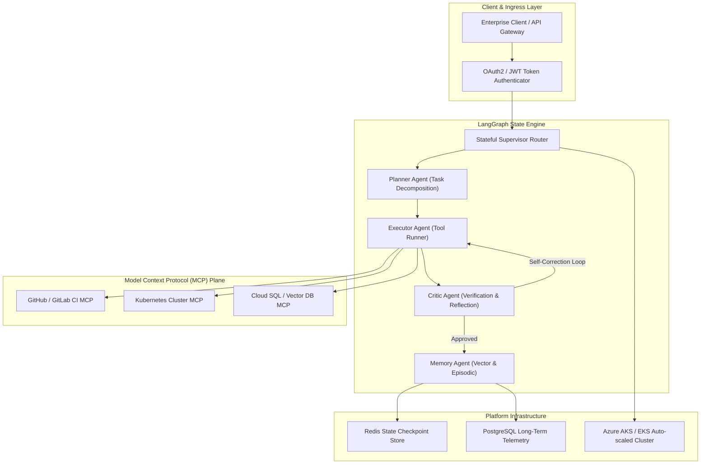

# Enterprise Agentic Operating System (`enterprise-agentic-os`)

[](https://pradeeptalari.me/projects/)
[](https://pradeeptalari.me/tools/repo-learning/)
[](https://pradeeptalari.me/projects/enterprise-agentic-os.html)
[](LICENSE)
[](SECURITY.md)
[](#-9-devsecops-governance-compliance-matrix)

Multi-agent orchestration platform coordinating specialized AI agents (Planner, Executor, Critic, Memory) using LangGraph stateful cyclic graphs to handle 500+ concurrent enterprise workflows.

---

## 🏗️ Production Architecture Flow



---

## 🧠 Core Engineering & Architectural Principles

### 1. Stateful Cyclic Graph Orchestration
Leverages LangGraph stateful cyclic graphs to maintain deterministic execution state, multi-step reflection loops, and persistent checkpointing, eliminating stateless prompt drift across 500+ concurrent enterprise workflows.

### 2. Dynamic MCP Tool Dispatch & Sandboxing
Implements Model Context Protocol (MCP) servers with dynamic capability discovery, isolated runtime sandboxing, and strict least-privilege tool execution permissions.

### 3. Dual-Tier Memory Fabric (Redis + pgvector)
Employs a tiered memory hierarchy: in-memory Redis for sub-millisecond session state locks and checkpoints, paired with PostgreSQL pgvector for semantic long-term episodic retrieval.

### 4. Reflection & Automated Critic Gateways
Separates planning from validation by enforcing an autonomous Critic agent that audits executor outputs against safety policies and schema constraints before payloads are finalized.

### 5. Deadlock Circuit Breaker & Fail-Safe Routing
Integrates automated recursion limit counters, circuit breaker timeouts, and graceful human-in-the-loop escalation gates to halt infinite agent deliberation loops.

---

## 💻 Infrastructure & Software Technology Stack

| Architectural Layer | Technology & Tools | Production Role |
|---|---|---|
| **Orchestration Framework** | LangGraph, LangChain | Stateful cyclic graph engine and agent persona coordinators |
| **API & Runtime Engine** | FastAPI, Python 3.11+, Pydantic v2 | High-throughput async REST/WebSocket agent runtime |
| **State & Session Storage** | Redis 7.2 Enterprise, PostgreSQL 16 | Distributed memory checkpointing, state locks, and execution audits |
| **Cluster Orchestration** | Kubernetes (Azure AKS / AWS EKS), KEDA | Auto-scaling agent worker pods based on queue depth |
| **DevSecOps & CI/CD** | ArgoCD, GitHub Actions, Helm | GitOps declarative deployment and continuous verification |

---

## 🎯 Where to Use (Real-World Production Scenarios)

1. **Autonomous DevOps Incident Remediation**:
   -  Diagnosing infrastructure incidents, analyzing Prometheus metrics, and executing verified remediation playbooks.
2. **Complex Document Analysis & Synthesis**:
   -  Ingesting multi-thousand page regulatory filings with coordinated planner, summarizer, and compliance auditor agents.
3. **Enterprise Software Release Coordination**:
   -  Orchestrating change management reviews, security scans, and progressive canary rollouts across microservices.
4. **Automated Support Escalation Dispatch**:
   -  Parsing unstructured customer inquiries, determining intent, and routing with verified context to tier-3 specialists.

---

## 🛠️ Step-by-Step SRE Deployment & Verification Runbook

### 1. Prerequisites
- Docker & Docker Compose (v2.20+)
- Python 3.10+ or Node.js 20+
- Git & GitHub CLI (`gh`)
- Valid cloud credentials (AWS / Azure / Kubernetes) if deploying live

### 2. Clone Repository
```bash
git clone https://github.com/Pradeeptalari14/enterprise-agentic-os.git
cd enterprise-agentic-os
```

### 3. Configure Safe Environment Template
```bash
cp .env.example .env
# Edit .env with your local or staging environment variables
```

### 4. Execute Automated Validation & Linting
```bash
bash scripts/validate.sh
```

### 5. Build & Launch Containerized Stack
```bash
docker compose up -d --build
# Verify health probe status
curl -s http://localhost:8000/health || echo "Service started"
```

---

## 🛡️ 9+ DevSecOps Governance Compliance Matrix

| Rule # | Requirement | Implementation in Repository | Status |
|---|---|---|---|
| **1** | **`README.md`** | Architecture DAG, core principles, technology stack, runbook, and compliance matrix | ✅ Complete |
| **2** | **`LICENSE`** | Permissive MIT Open Source License (Copyright © 2026 Talari Pradeep) | ✅ Verified |
| **3** | **`SECURITY.md`** | Vulnerability disclosure SLAs, supported versions, secret policies | ✅ Verified |
| **4** | **`.gitignore`** | Hardened against .env, __pycache__, credentials, build artifacts | ✅ Cleaned & Active |
| **5** | **`.env.example`** | Safe template with model endpoints, Redis parameters, and concurrency limits | ✅ Provided |
| **6** | **`.pre-commit-config.yaml`** | Gitleaks secret scans, YAML/JSON linters, trailing whitespace checks | ✅ Configured |
| **7** | **`.github/workflows/`** | Automated CI validation pipeline (sre-validation.yml) & Dependabot updates | ✅ Enabled |
| **8** | **`docs/ Knowledge Suite`** | TROUBLESHOOTING.md, GLOSSARY.md, COMPLIANCE.md | ✅ Documented |
| **9** | **`scripts/validate.sh`** | Automated syntax, dependency, and health checking verification script | ✅ Executable |
| **10** | **`CHANGELOG.md`** | Structured release notes following Keep-a-Changelog standard | ✅ Maintained |

---

*Synchronized with [Enterprise Agentic Operating System](https://pradeeptalari.me/projects/enterprise-agentic-os.html) & [Architecture Center](https://pradeeptalari.me/architecture/) — [Talari Pradeep Portfolio](https://pradeeptalari.me)*
